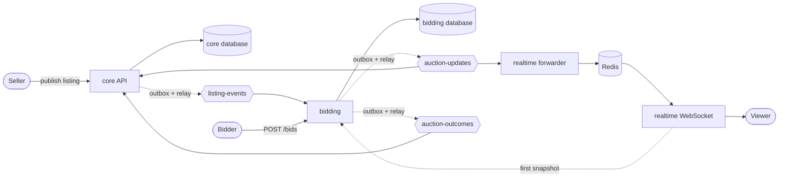

# going-once

A live auction house backend. Sellers publish listings, bidders place proxy bids, the
auction closes itself at the deadline, and viewers watch the price change in real time
over WebSocket.

The interesting part is not the endpoints. It is what stays true when things fail: a
bid is never half-recorded, a retried request never bids twice, an auction closes exactly
once even with several closers racing, and a crash between "write to the database" and
"tell Kafka" loses nothing.

Python, FastAPI, Postgres, Redis, Kafka, SQLAlchemy (async), Alembic, Docker Compose.

## Architecture



| Service | Owns | Does not do |
|---|---|---|
| **core API** (`services/api`) | users, listings, orders | take bids, close auctions, serve viewers |
| **bidding** (`services/bidding`) | auction state, bids, the closer | know about users beyond a JWT |
| **realtime** (`services/realtime`) | nothing (no database) | accept bids, see private data |

Services never call each other on the request path and never share tables. They talk
through Kafka topics whose message shapes live in one package, `contracts/`.

| Topic | From | To | Audience |
|---|---|---|---|
| `listing-events` | core API | bidding | private (carries the reserve price) |
| `auction-updates` | bidding | core API, realtime | public |
| `auction-outcomes` | bidding | core API | private (names the winner) |

More in [docs/ownership.md](docs/ownership.md): who owns what, and why the topics are split.

## Design decisions

- **Transactional outbox.** A state change and the event announcing it are written in one
  database transaction. A separate relay sends the rows to Kafka (idempotent producer,
  `acks=all`, advisory lock so only one relay runs). A crash can delay an event but cannot
  lose it or announce something that was rolled back.
- **At-least-once consumers that tolerate repeats.** Offsets are committed after the work
  is committed. Every event carries a version, and applying an old or repeated one changes
  nothing. Malformed messages are skipped, since retrying cannot fix them; infrastructure
  errors are retried forever, since skipping would lose data.
- **Proxy bidding.** A bid is a ceiling. The leader pays the best rival's ceiling plus one
  increment, never more than their own ceiling, and the price does not depend on the order
  bids arrived in. Every bid takes a row lock on its auction, so bids on one auction apply
  one at a time.
- **Idempotent bids.** Each bid carries an `Idempotency-Key`. Retrying the same request
  returns the same bid; reusing the key for a different amount is a 409.
- **Anti-snipe.** A bid in the final window pushes the deadline out.
- **Settlement.** The winner pays the second price, but never less than the reserve. No
  bids, or a best ceiling below the reserve, means unsold. Each close is one transaction
  (status, version and both events), and closers use `SKIP LOCKED` so several can run at
  once without closing anything twice.
- **Commit before response.** A `201` means the bid is already committed, so a client that
  reads straight after sees it.
- **Realtime without a database.** The first message on a socket is a snapshot fetched
  from bidding. After that, updates flow Kafka, then Redis pub/sub, then the socket. The
  socket sends only versions newer than the last it sent, which closes the gap between
  snapshot and stream. A viewer that stops reading is dropped instead of slowing others.
  Only the public event type is forwarded, so private fields cannot reach a browser.

## What is proven

Tests assert the failure behaviour, not only the happy path, and the important ones were
checked by breaking the code on purpose and watching them fail:

- a crash mid-bid leaves no bid, no price change and no event
- the same request sent twice at once makes one bid
- a `201` is only returned after the commit (measured from a second connection)
- four closers racing settle each auction exactly once
- a crash mid-close leaves the auction live, and a retry finishes it
- the relay resends a failed batch in full, and a broker outage loses nothing
- random bid sequences match an independent model of the pricing rule (this found a real
  bug: raising your own ceiling used to leave the price stale)
- the core API has no viewer WebSocket any more (checked end to end)
- when Redis drops, connected viewers are told to reconnect instead of staying stale (the test cuts the real connection)

## Run it

You need Docker with Compose. Compose reads a git-ignored `.env` at the repo root for the
database URL and the JWT signing secret.

```bash
docker compose up -d --build --remove-orphans
docker compose exec api python -m alembic upgrade head   # core API schema
./scripts/smoke.sh                                       # end-to-end check
```

`smoke.sh` registers users, publishes a listing, bids, watches the auction on the realtime
service, lets the closer end it, and checks the sale and the order. It ends with
`ALL CHECKS PASSED`.

| Service | Port |
|---|---|
| core API | 8000 |
| bidding | 8001 |
| realtime | 8002 |

## Tests

Each service has its own suite and its own database. From a service folder:

```bash
ruff check . && ruff format --check . && mypy app && python -m pytest -q
```

Tests that need a Kafka broker are skipped when none is reachable. The smoke test covers
that path against the real stack.

## Layout

```
contracts/         event models shared by every service (the only shared code)
services/api/      users, listings, orders; publishes listing-events
services/bidding/  bids, auction state, the closer; owns the pricing and settlement rules
services/realtime/ WebSocket fan-out; no database
scripts/           smoke.sh and the WebSocket watcher it uses
docs/              ownership.md
docker-compose.yml
```

## Known limits

- A new viewer cannot connect while bidding is down, because the first snapshot comes
  from bidding. Viewers already connected keep their stream.
- Bidding trusts a valid JWT and does not check that the user is still active.
- If Redis drops, every connected viewer is closed with code 1013 and must reconnect for a
  fresh snapshot, because updates sent during the gap are not replayed. A connection that
  dies silently (no reset, as in a network partition) is only noticed on the next failed read.

## Not built yet

React client, a settlement saga (payment capture and fulfilment), metrics and tracing,
load and chaos testing, and a cloud deployment with Terraform.